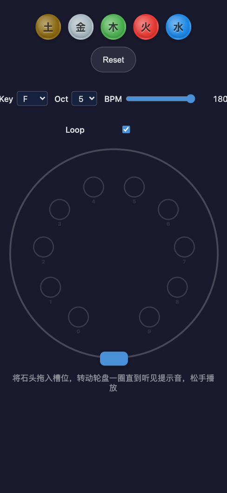
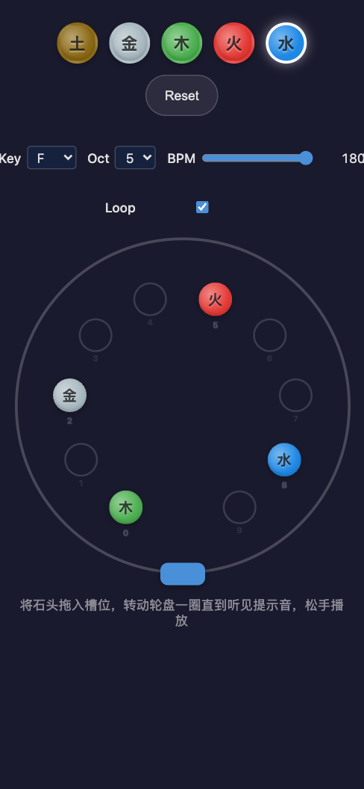
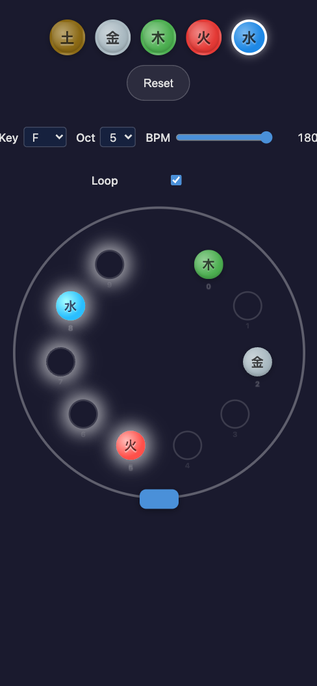
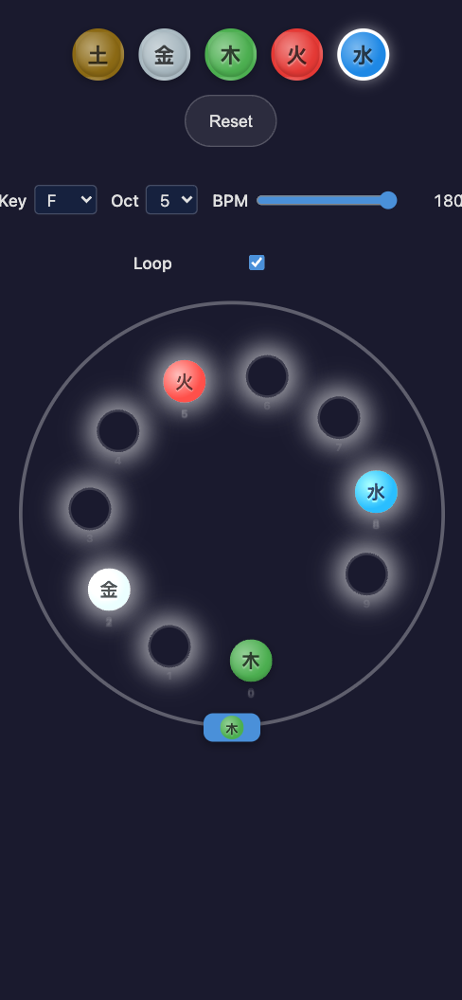
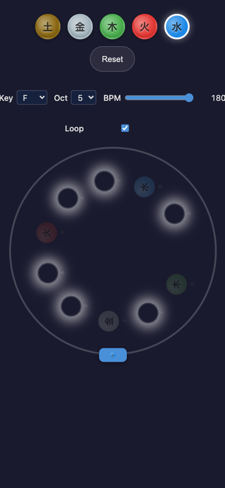

# Five-Element Wheel · 五行轮盘

A digital art instrument that turns the Chinese five elements (五行 / wǔ xíng) into music. Place colored stones on a rotating wheel, drag to queue a sequence, release to play — any arrangement sounds consonant.

Built around the pentatonic scale (五音 / wǔ yīn): **Earth** (root), **Metal** (M2), **Wood** (M3), **Fire** (P5), **Water** (M6). The intervals form a perfect pentatonic scale in any key — you cannot make a "wrong" note.

---

## Concept

五行 (Five Elements) is an ancient Chinese philosophy describing the five fundamental phases of the natural world:

| Element | Character | Note (key=C) | Color |
|---------|-----------|--------------|-------|
| Earth (土) | Stability, soil | Root (宫 / Do) | `#8B6914` |
| Metal (金) | Structure, geometry | M2 (商 / Re) | `#A8B8C0` |
| Wood (木) | Growth, foliage | M3 (角 / Mi) | `#4CAF50` |
| Fire (火) | Energy, flame | P5 (徵 / Sol) | `#E53935` |
| Water (水) | Flow, adaptability | M6 (羽 / La) | `#1E88E5` |

These five elements map to the five notes of the Chinese pentatonic scale (五音). The intervals are consonant in every key — any combination of stones on the wheel produces a harmonious melody.

**Intentions:** This project explores gesture-as-composition. The wheel is not a sequencer grid or a piano roll — it's a physical metaphor. Drag to queue, release to play, loop and re-shape in real time. The constraint (five notes, ten slots, one wheel) creates a space for meditative, improvisational music-making.

---

## Features & User Experience

### Mobile-First, Gesture-Driven

The app is designed for touch from the ground up. All interactions work with drag and tap — no keyboard shortcuts required.

#### 1. Place Stones

Two ways to place a stone in a slot:

- **Tap-to-place:** Tap a stone in the palette to select it (white glow), then tap any empty slot
- **Drag-to-place:** Drag a stone from the palette onto a slot — a ghost stone follows your finger, snaps to the nearest slot within 30px

| Empty slot | Slot with stone |
|------------|----------------|
| Grey ring with index number | Colored circle with element symbol |

To **remove** a stone: tap a filled slot while the matching stone is selected, or drag the stone off the wheel.

#### 2. Wind the Wheel

Drag the wheel clockwise or counter-clockwise. As each slot crosses the fixed **Head** at 6 o'clock, it becomes **queued** — the slot glows to confirm capture. The order of capture determines the play order.

| What you see | What it means |
|--------------|---------------|
| Strong glow on a slot | Slot is queued — will play |
| No glow on approaching slot | Not yet captured |

Drag further to queue more slots. Drag a full rotation (360°) to queue all 10 — a **tack sound** (noise burst + sine blip) confirms you've reached the limit. The wheel is capped at ±360°.

#### 3. Release to Play

Release the wheel. It **springs back** to its rest position while playing queued slots in encounter order:

- Each slot plays for one beat at the current BPM
- Empty slots are rests — the beat grid is always maintained
- Spring-back duration = `queuedSlots × (60 ÷ BPM)` seconds

The **Head** shows the currently playing stone icon, and non-playing filled slots dim.

#### 4. Loop Mode

With **Loop** enabled (default), the melody repeats seamlessly:
- No gaps between iterations — playback pre-schedules multiple cycles and extends dynamically
- **Edit during playback:** Drag new stones into slots or remove existing ones — changes apply to all future beats immediately (hot reload)
- The wheel stays at rest during loop

#### 5. Interrupt the Loop

Drag the wheel during playback to interrupt the current sequence and queue a new one. The transition requires a deliberate 15° drag to prevent accidental interruption during stone editing.

#### 6. Controls

| Control | Range | Default | Description |
|---------|-------|---------|-------------|
| **Key** | C, C#, D, …, B | F | Root note of the pentatonic scale |
| **Octave** | 3 – 8 | 5 | Transposition for all frequencies |
| **BPM** | 60 – 180 | 180 | Tempo — controls playback speed |
| **Loop** | On / Off | On | Toggle seamless melody repetition |
| **Reset** | Button | — | Restore app to clean initial state |

All controls are usable during playback.

---

## Visual Design

Dark-themed with glow-based feedback for slot states:

| Class | Purpose |
|-------|---------|
| `slot--queued` | Strong glow on captured slots during winding |
| `slot--playing` | Bright glow on currently-playing slot |
| `slot--dimmed` | Dimmed non-playing filled slots during spring-back |
| `slot--glow` | Snap target highlight during stone drag |
| `wheel-container--winding` | Wheel border brightens during drag |
| `wheel-container--spring-back` | Blue-tinted glow during playback |
| `wheel-container--tack-flash` | Brief bounce animation at 360° |

The ghost stone follows the cursor during stone drag and fades out on release over 200ms.

---

## Screenshots

| State | Preview |
|-------|---------|
| Empty wheel with hint |  |
| Stones placed in slots |  |
| Wheel winding, slots queued |  |
| Full rotation — tack threshold |  |
| Spring-back playback |  |

---

## Technical Stack

| Layer | Technology |
|-------|-----------|
| Framework | Vite + React 18 + TypeScript (strict mode) |
| State | Single `useReducer` — no external library |
| Audio | Native Web Audio API (OscillatorNode triangle wave + GainNode pluck envelope) |
| Styling | Plain CSS with custom properties, BEM naming |
| Interaction | Raw pointer events — angular-only drag for wheel, document-level for stone drag |
| Rotation | CSS `transform: rotate()` with inline transition override for spring-back |
| PWA | `vite-plugin-pwa` with workbox `generateSW`, offline precache |
| Testing | Vitest + jsdom — 107 tests, 204 assertions |

### Architecture (flat `src/`)

```
src/
  main.tsx, App.tsx           — entry + root component
  types.ts                    — ElementType, WheelState, WheelAction, element data
  frequencies.ts              — getElementFrequencies() pure music theory
  wheelReducer.ts             — pure reducer + initialWheelState (handles all actions)
  wheelReducer.test.ts        — state machine + action tests
  playback.ts                 — AudioContext singleton, tack sound, rAF-scheduled engine
  playback.test.ts            — updateSlots + frequency tests
  useWheelGesture.ts          — pointer-drag gesture hook (angular delta + commit threshold)
  useWheelPlayback.ts         — hook: tack detection, spring-back lifecycle, hot-reload sync
  useSlotDrag.ts              — hook: stone drag from palette to slot
  geometry.ts                 — getSlotPosition(), findSnapTarget(), angle constants
  Wheel.tsx                   — render component: gesture + playback hooks → dispatch + layout
  Slot.tsx                    — slot render: empty/filled/queued/playing/dimmed/snap-target
  Head.tsx                    — fixed marker at 6 o'clock
  StonePalette.tsx            — 5 stone circles + Reset + stone drag gesture
  LoopToggle.tsx              — checkbox toggle for loop
  BPMControl.tsx              — Key selector + Octave selector + BPM slider
  index.css                   — all styles
```

### Key Architecture Decisions

- **State machine with 3 modes:** `ready` → `winding` → `springBack`. Tack is a derived value (rotation ≥ 360°), not a mode.
- **Pure reducer:** All state transitions are deterministic, testable functions. No side effects in the reducer.
- **Audio clock synced to rAF:** Beat timing computed from `AudioContext.currentTime`, visual updates driven by `requestAnimationFrame`.
- **Hot reload during loop:** `PlaybackControl.updateSlots()` cancels future scheduled oscillators and re-schedules with new elements. Already-played beats remain unchanged.
- **Commit threshold:** 15° drag required during springBack to interrupt the loop — prevents accidental interruption during stone editing.

---

## Dev Guide

### Prerequisites

- [bun](https://bun.sh) 1.3+

### Clone and Run

```bash
git clone https://github.com/your-username/five-element-wheel
cd five-element-wheel
bun install
bun dev
```

Opens at `http://localhost:5173/` (or next available port).

### Scripts

| Command | Description |
|---------|-------------|
| `bun dev` | Start dev server with hot reload |
| `bun build` | Production build to `dist/` |
| `bun preview` | Preview production build locally |
| `bun test` | Run full test suite (107 tests) |
| `bunx tsc --noEmit` | Type check without emitting |

### Project Dependencies

```json
{
  "dependencies": {
    "react": "^19",
    "react-dom": "^19"
  },
  "devDependencies": {
    "@vitejs/plugin-react": "^4",
    "vite": "^6",
    "vite-plugin-pwa": "^1",
    "vitest": "^3",
    "typescript": "^5",
    "jsdom": "^25"
  }
}
```

### Building

```bash
bun build
```

Output goes to `dist/`. The build produces a fully offline-capable PWA with service worker and asset precaching.

### Testing Philosophy

The test suite (107 tests, 204 assertions) focuses on:

- **Reducer purity:** Every state transition is tested in isolation — no component, no audio context
- **Edge cases:** Mode guards, direction changes, empty slots, boundary conditions
- **Playback logic:** `updateSlots()` behavior with hot reload, timing calculations, frequency correctness

Run the full suite with:

```bash
bun test
```

---

## Project Status

This is a digital art exploration piece — not a product, not a DAW, not a game. It's complete as a standalone instrument and open for anyone to build on.

### What it is

- A constraint-based composition tool
- A gesture-to-music interface
- A visual exploration of the five-element philosophy

### What it is not

- A full music production environment
- A game with scoring or goals
- A puzzle with right/wrong answers

---

## Further Reading

- Architecture decisions: [`docs/adr/`](docs/adr/)
- Domain glossary: [`CONTEXT.md`](CONTEXT.md)
- Agent documentation: [`AGENTS.md`](AGENTS.md)
