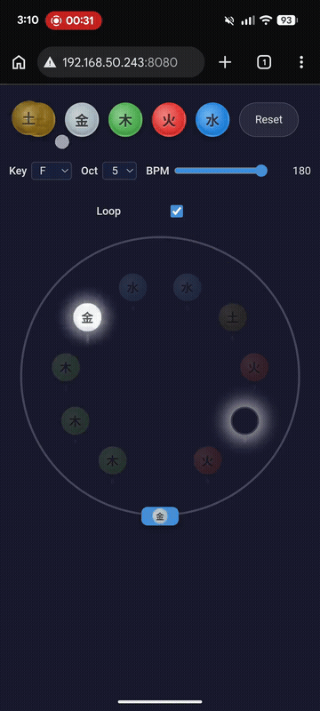

# Five-Element Wheel · 五行轮盘

The Chinese five elements (五行 / wǔ xíng) mapped to a pentatonic scale. Place colored stones on a rotating wheel, drag to queue a sequence, release to play. Every combination of stones produces a consonant melody.

Built around the pentatonic scale (五音 / wǔ yīn): **Earth** (root), **Metal** (M2), **Wood** (M3), **Fire** (P5), **Water** (M6). The intervals form a pentatonic scale in any key. No wrong notes.

---

## Concept

五行 (Five Elements) is an ancient Chinese philosophy describing five phases of the natural world:

| Element | Character | Note (key=C) | Color |
|---------|-----------|--------------|-------|
| Earth (土) | Stability, soil | Root (宫 / Do) | `#8B6914` |
| Metal (金) | Structure, geometry | M2 (商 / Re) | `#A8B8C0` |
| Wood (木) | Growth, foliage | M3 (角 / Mi) | `#4CAF50` |
| Fire (火) | Energy, flame | P5 (徵 / Sol) | `#E53935` |
| Water (水) | Flow, adaptability | M6 (羽 / La) | `#1E88E5` |

These five elements map to the five notes of the Chinese pentatonic scale (五音). The intervals are consonant in every key.

**Intentions:** The wheel is a physical metaphor for composing with gestures. Drag to queue, release to play, loop and re-shape in real time. Five notes, ten slots, one wheel.

---

## Demo

[](https://streamable.com/lpduul)

**▶ Watch the full demo (74s, with sound):** [Streamable](https://streamable.com/lpduul) (online until Jan 31, 2027) · [MP4 in the repo](docs/demo/demo.mp4) (permanent)

---

## Features & User Experience

### Mobile-First, Gesture-Driven

The app is designed for touch. All interactions work with drag and tap, no keyboard shortcuts required.

#### 1. Place Stones

Two ways to place a stone in a slot:

- **Tap-to-place:** Tap a stone in the palette to select it (white glow), then tap any empty slot.
- **Drag-to-place:** Drag a stone from the palette onto a slot. A ghost stone follows your finger and snaps to the nearest slot within 30px.

| Empty slot | Slot with stone |
|------------|----------------|
| Grey ring with index number | Colored circle with element symbol |

To **remove** a stone: tap a filled slot while the matching stone is selected, or drag the stone off the wheel.

#### 2. Wind the Wheel

Drag the wheel clockwise or counter-clockwise. As each slot crosses the fixed **Head** at 6 o'clock, it becomes **queued** and glows to confirm capture. The order of capture determines the play order.

| What you see | What it means |
|--------------|---------------|
| Strong glow on a slot | Slot is queued, will play |
| No glow on approaching slot | Not yet captured |

Drag further to queue more slots. A full rotation (360°) queues all 10. A **tack sound** (noise burst + sine blip) confirms you've reached the limit. The wheel is capped at ±360°.

#### 3. Release to Play

Release the wheel. It **springs back** to its rest position while playing queued slots in encounter order:

- Each slot plays for one beat at the current BPM.
- Empty slots are rests. The beat grid is always maintained.
- Spring-back duration = `queuedSlots × (60 ÷ BPM)` seconds.

The **Head** shows the currently playing stone icon. Non-playing filled slots dim.

#### 4. Loop Mode

With **Loop** enabled (default), the melody repeats seamlessly. Playback pre-schedules multiple cycles and extends dynamically. You can edit stones during playback -- drag new ones into slots or remove existing ones. Changes apply to all future beats immediately (hot reload). The wheel stays at rest during loop.

#### 5. Interrupt the Loop

Drag the wheel during playback to interrupt the current sequence and queue a new one. The transition requires a deliberate 15° drag to prevent accidental interruption during stone editing.

#### 6. Controls

| Control | Range | Default | Description |
|---------|-------|---------|-------------|
| **Key** | C, C#, D, …, B | F | Root note of the pentatonic scale |
| **Octave** | 3 – 8 | 5 | Transposition for all frequencies |
| **BPM** | 60 – 180 | 180 | Tempo, controls playback speed |
| **Loop** | On / Off | On | Toggle melody repetition |
| **Reset** | Button | — | Restore app to clean initial state |

All controls work during playback.

---

## Technical Stack

| Layer | Technology |
|-------|-----------|
| Framework | Vite + React 18 + TypeScript (strict mode) |
| State | Single `useReducer`, no external library |
| Audio | Native Web Audio API (OscillatorNode triangle wave + GainNode pluck envelope) |
| Styling | Plain CSS with custom properties, BEM naming |
| Interaction | Raw pointer events, angular-only drag for wheel, document-level for stone drag |
| Rotation | CSS `transform: rotate()` with inline transition override for spring-back |
| PWA | `vite-plugin-pwa` with workbox `generateSW`, offline precache |
| Testing | Vitest + jsdom, 107 tests, 204 assertions |

### Architecture (flat `src/`)

```
src/
  main.tsx, App.tsx           — entry + root component
  types.ts                    — ElementType, WheelState, WheelAction, element data
  frequencies.ts              — getElementFrequencies() pure music theory
  wheelReducer.ts             — pure reducer + initialWheelState (handles all actions)
  wheelReducer.test.ts        — state machine + action tests
  playback.ts                 — AudioContext singleton, tack sound, rAF-scheduled engine
  playback.test.ts            — updateSlots + frequency tests
  useWheelGesture.ts          — pointer-drag gesture hook (angular delta + commit threshold)
  useWheelPlayback.ts         — hook: tack detection, spring-back lifecycle, hot-reload sync
  useSlotDrag.ts              — hook: stone drag from palette to slot
  geometry.ts                 — getSlotPosition(), findSnapTarget(), angle constants
  Wheel.tsx                   — render component: gesture + playback hooks → dispatch + layout
  Slot.tsx                    — slot render: empty/filled/queued/playing/dimmed/snap-target
  Head.tsx                    — fixed marker at 6 o'clock
  StonePalette.tsx            — 5 stone circles + Reset + stone drag gesture
  LoopToggle.tsx              — checkbox toggle for loop
  BPMControl.tsx              — Key selector + Octave selector + BPM slider
  index.css                   — all styles
```

### Key Architecture Decisions

The state machine has 3 modes: `ready` → `winding` → `springBack`. Tack is derived from rotation (≥ 360°), not stored as a mode. All state transitions go through a pure reducer: deterministic, testable, no side effects.

Audio timing comes from `AudioContext.currentTime`, synced to the visual frame loop via `requestAnimationFrame`. During loop playback, `PlaybackControl.updateSlots()` cancels future oscillators and re-schedules with new elements. This means stone edits during playback take effect on the next beat. Already-played beats are left alone.

A 15° commit threshold on wheel drag prevents accidental loop interruption during stone editing. You have to drag deliberately past that angle before the interrupt fires.

---

## Dev Guide

### Prerequisites

- [bun](https://bun.sh) 1.3+

### Clone and Run

```bash
git clone https://github.com/nekobuff69/five-element-wheel
cd five-element-wheel
bun install
bun dev
```

Opens at `http://localhost:5173/` (or next available port).

### Scripts

| Command | Description |
|---------|-------------|
| `bun dev` | Start dev server with hot reload |
| `bun build` | Production build to `dist/` |
| `bun preview` | Preview production build locally |
| `bun test` | Run full test suite (107 tests) |
| `bunx tsc --noEmit` | Type check without emitting |

### Project Dependencies

```json
{
  "dependencies": {
    "react": "^19",
    "react-dom": "^19"
  },
  "devDependencies": {
    "@vitejs/plugin-react": "^4",
    "vite": "^6",
    "vite-plugin-pwa": "^1",
    "vitest": "^3",
    "typescript": "^5",
    "jsdom": "^25"
  }
}
```

### Building

```bash
bun build
```

Output goes to `dist/`. The build produces a fully offline-capable PWA with service worker and asset precaching.

### Testing Philosophy

The test suite covers three areas: reducer purity (state transitions in isolation, no components or audio context), edge cases (mode guards, direction changes, empty slots, boundary conditions), and playback logic (updateSlots behavior with hot reload, timing calculations, frequency correctness).

```bash
bun test
```

---

## Project Status

A hobby project. A musical gadget that makes nice sounds when you drag stones around a wheel. Not a proper instrument with expectations. Just something to play with, zero pressure.

If you want to build on it, go ahead.

---

## Further Reading

- Architecture decisions: [`docs/adr/`](docs/adr/)
- Domain glossary: [`CONTEXT.md`](CONTEXT.md)
- Agent documentation: [`AGENTS.md`](AGENTS.md)
